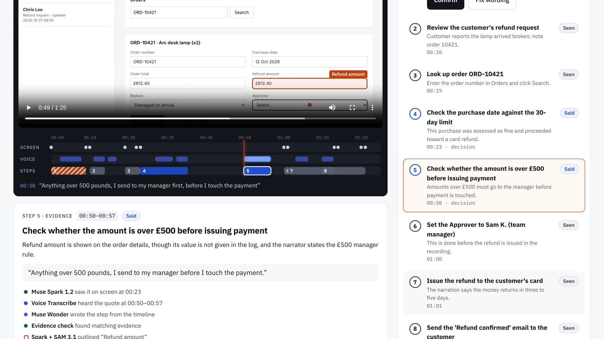
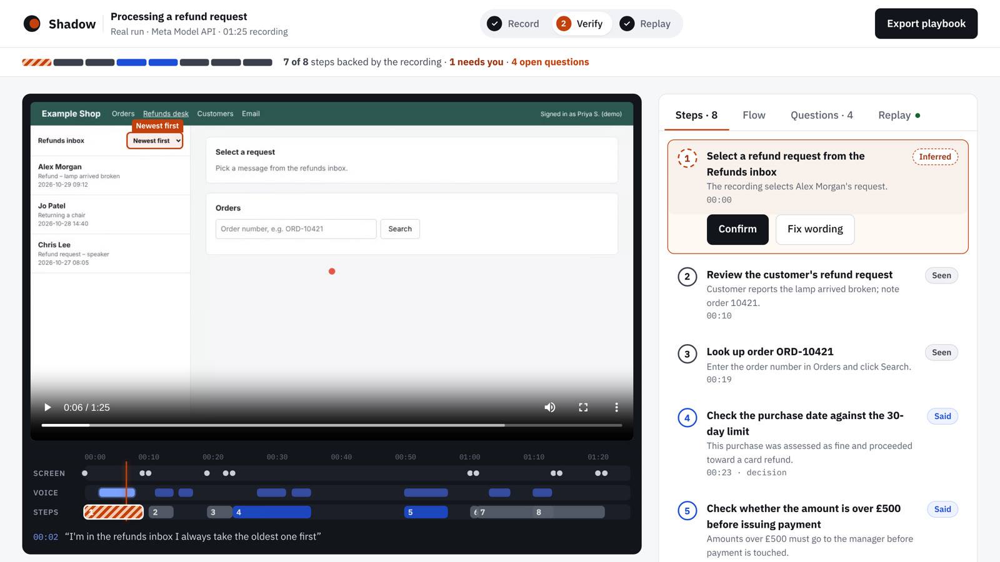
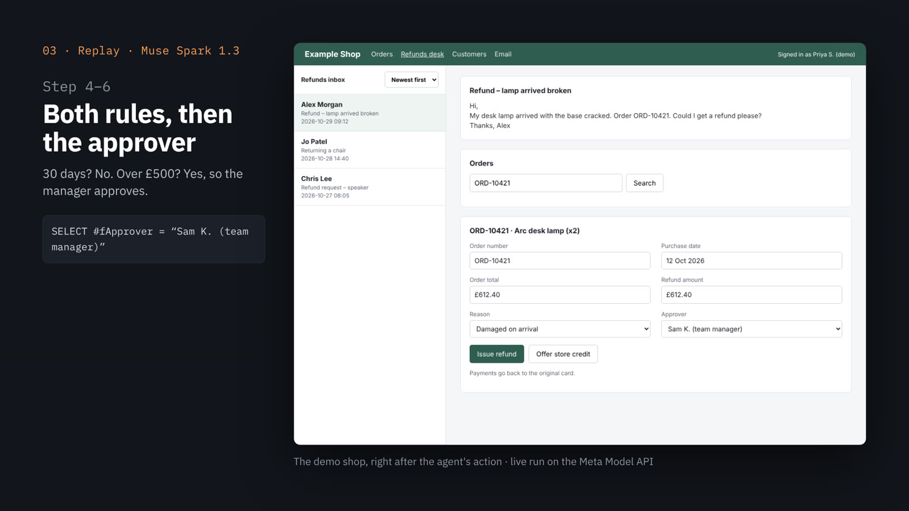

# Shadow — show it once

**Shadow turns an expert's screen recording and narration into a reviewable playbook, with every step tied to its source and every assumption called out. Then an agent does the job back, and stops to ask wherever the recording never showed it.**

**Record → Verify → Replay.** Built for the Meta Global AI Developer Hackathon (Indie track, *Build for Your World*).

- **Live:** https://mukeshkbj--shadow-web.us-east.modal.run. Open the featured run (a real run on the Meta Model API). Uploading a new recording needs a passcode, because each upload spends API credits.
- **Demo video (3 min):** see the submission page.
- **Open weights:** the same recording run through **Muse Spark Open** on Nebius is the second playbook on the live site (see [Open-weights mode](#open-weights-mode-muse-spark-open)).



## Why
Every team has one person who knows how the job is really done. AI can write a procedure from a video now, but it fills the gaps with confident guesses, and a procedure you can't check is worse than none. Shadow's whole design is about **evidence and uncertainty**: what was seen, what was said, what Shadow is only inferring, and what nobody showed.

## What it does
1. **Record.** Someone records their screen while doing a task and talks as they go.
2. **Muse Spark 1.2** watches the video *with* its audio and logs what was **seen** on screen and what was **said**, with timestamps.
3. **Muse Voice Transcribe** times every spoken line. Spoken events take their time from the transcript (Spark's times for speech drift by seconds; see below), and every "Said" quote must appear in the narration turn spoken at that moment.
4. **Muse Wonder** drafts the playbook from that log. Every step is labelled **Seen**, **Said** or **Inferred**; decisions get branches; branches nobody showed become **open questions**, not guesses.
5. **Evidence check** (plain code, no AI) verifies every step against the log. No evidence: the step becomes a question. A "Said" quote that wasn't heard: downgraded to Inferred.
6. **Muse Spark + SAM 3.1** draw a visual pointer for the reviewer: SAM can't read labels, so Spark finds the field by its label and SAM 3.1 outlines it. It helps you look; it is not proof.
7. **Verify.** The expert reviews on one timeline (screen, voice, steps). Click any step and the video jumps to its moment. When screen and voice disagree, Shadow flags the step instead of choosing: in the demo she says "I always take the oldest one first" while the inbox is sorted *newest first*.
8. **Replay.** **Muse Spark 1.3** drives the real app from the confirmed playbook, one action at a time, using only the rules the expert said aloud. It stops and asks at every unconfirmed step and every branch the recording never showed.
9. Export a cited playbook (Markdown) and a flow diagram (Mermaid).

| Screen and voice disagree → Shadow asks | Replay: the agent does the job back |
|---|---|
|  |  |

## Measured accuracy
We scripted recordings of the demo app with known timings (`recordings/*.ground_truth.json`) so timestamps are scored, not eyeballed. Reproduce with `python scripts/score.py <job> recordings/<take>.ground_truth.json`.

| What | Featured run (85 s take) | Earlier take (87 s) |
|---|---|---|
| On-screen actions, Muse Spark 1.2 (avg / worst) | **0.5 s** / 1.0 s | **0.5 s** / 1 s |
| Spoken lines, timed by Muse Spark (avg / worst) | 3.8 s / 9 s | 6.4 s / 14.5 s |
| Spoken lines, snapped to Voice Transcribe turns (avg / worst) | **0.18 s** / 0.26 s | **0.3 s** / 0.5 s |

That gap is why spoken events take their time from the transcript.

**Known limits, stated plainly.** Muse Spark sometimes misreads small on-screen numbers: in one run it read £612.40 as £812.40. The evidence check verifies *that* something was seen or said, not every digit, which is why every step links to its moment in the video and the expert confirms. On the featured run, Replay completed all 8 steps (9 actions, 2 decisions) and asked the expert once, at the unconfirmed step.

## Run it (Windows)
Needs Python 3.10+, Node 18+ and ffmpeg on PATH.

```powershell
# backend
cd backend
python -m venv .venv
.venv\Scripts\activate
pip install -r requirements.txt
$env:MODEL_API_KEY = "<your Meta Model API key>"   # leave unset to use the offline sample only
uvicorn shadow.api:app --reload --port 8000

# UI (second terminal)
cd frontend
npm install
npm run dev        # http://localhost:5173
# or: npm run build, then open http://localhost:8000 (the API serves the built UI)
```

### Settings (environment variables)
| Variable | Default | Meaning |
|---|---|---|
| `MODEL_API_KEY` | (unset) | Meta Model API key. Unset = offline sample only |
| `SHADOW_TIMELINE_MODEL` | `muse-spark-1.2` | Pass 1. 1.2 because audio on 1.3 is "not fully supported" |
| `SHADOW_PLAYBOOK_MODEL` | `muse-wonder-1.0` | Pass 2 |
| `SHADOW_WINDOW_SECONDS` | `0` | `0` = whole video in one call; `30` = 30-second windows (timestamps correct by construction) |
| `SHADOW_MAX_OUTPUT_TOKENS` | `12000` | Min 4000: reasoning shares the output budget |
| `SHADOW_TRANSCRIBE` | `1` | Check "Said" quotes against Muse Voice Transcribe turns (`0` = off) |
| `SHADOW_POINTER` | `1` | Add SAM 3.1 visual pointers (`0` = off) |
| `SHADOW_OPEN_BASE_URL` | (unset) | Open-weights mode host, e.g. `https://inference.baseten.co/v1` |
| `SHADOW_OPEN_API_KEY` | (unset) | Key for that host |
| `SHADOW_UPLOAD_PASSCODE` | (unset) | If set, uploads need this passcode (viewing stays open) |
| `SHADOW_OPEN_MODEL` | `meta-models/muse-spark-open` | Muse Spark Open model ID on that host |

### Tests
```powershell
cd backend; python -m pytest -q
```
Includes a full pipeline run against a fake Meta API with a generated video, which checks windowing, timestamp offsets and the evidence rules.

## Open-weights mode (Muse Spark Open)
Pick **Open weights** on the upload screen to run the watching and writing passes on **Muse Spark Open**, Meta's open-weight model, through any OpenAI-compatible host. The live app uses **Nebius Token Factory** (`meta-models/muse-spark-open`), paid from our own account: the hackathon's Baseten credits went to a pre-selected group and didn't reach us, so we used Nebius instead. Any OpenAI-compatible host works (Baseten, Fireworks, Modal, your own vLLM) by changing `SHADOW_OPEN_BASE_URL`.

Hosts take video but not audio (Nebius rejects audio parts), so Shadow does the listening separately: **Muse Voice Transcribe** transcribes the narration first, and each 30-second video window goes to Muse Spark Open together with the narration lines for that window, with their times, as text. Voice Transcribe and SAM 3.1 still check quotes and draw pointers. Set `SHADOW_OPEN_AUDIO=1` for a host that does accept audio.

**Featured open-weights run** (`refund-open` on the live site, same 85-second take):

| What | Muse Spark Open on Nebius |
|---|---|
| On-screen actions (avg / worst) | **0.21 s** / 0.5 s, from 30-second windows |
| Spoken lines | come from the transcript given to it as text (0.05 s avg after snapping), so this measures Voice Transcribe, not the open model |
| Playbook | 6 steps (3 Seen, 2 Said, 1 Inferred), 2 decisions, 3 open questions; it flagged the same "oldest first" vs "Newest first" conflict |

## Replay: the agent does the job back
Once the expert has confirmed the playbook, Shadow can **re-run it** in the app it was recorded in.
An agent loop shows Muse Spark the live page (screenshot + DOM snapshot) plus the rules the expert
said aloud, and performs each step itself. It stops — rather than guesses — at any step still
unconfirmed, and at any branch the recording never showed, and asks the expert before continuing.

```powershell
cd backend; .venv\Scripts\pip install playwright; .venv\Scripts\python -m playwright install chromium
cd ..
python scripts\replay.py <job_id>            # headed browser; answers prompts in the terminal
python scripts\replay.py <job_id> --auto     # skip every unconfirmed/unshown stop (unattended)
```

Screenshots and `replay_log.json` land in the job's `replay/` folder. Playwright is an optional,
local-only dependency — it is not in `requirements.txt` and not in the deployed app.

## Deploy (Modal)
From PowerShell in this folder: `.\deploy.ps1` (set `$env:MODEL_API_KEY` first so uploads work live). It links your Modal account the first time, stores the settings as the `shadow-secrets` secret, builds the UI and deploys. Details are in `modal_app.py`.

## Demo data
`demo-prop/index.html` is a fictional shop back office with made-up orders, used for the demo recording. `demo-prop/RECORDING.md` is the narration script. No real customer data is used anywhere.

## Built during the hackathon
All code in this repository was written during the hackathon building period (from 29 Oct 2026): pipeline, evidence check, exporters, API, review UI, demo prop and tests.

## Project layout
```
backend/shadow/   passes.py (Pass 1, 2) · evidence.py (Pass 3) · providers.py (Meta API / open weights)
                  transcribe.py (Voice Transcribe) · pointer.py (SAM 3.1) · replay.py (agent re-run)
                  exporters.py · muse.py · api.py
modal_app.py      Modal deployment
backend/fixtures/ sample timeline + draft playbook (offline sample)
frontend/src/     review UI (React + Vite)
demo-prop/        fictional refunds desk to record
scripts/probe.py  timestamp gate test against the real API
scripts/replay.py Replay: drives the demo prop through a confirmed playbook (Playwright + Muse)
scripts/score.py  scores a job's timestamps against a scripted take's ground truth
```
